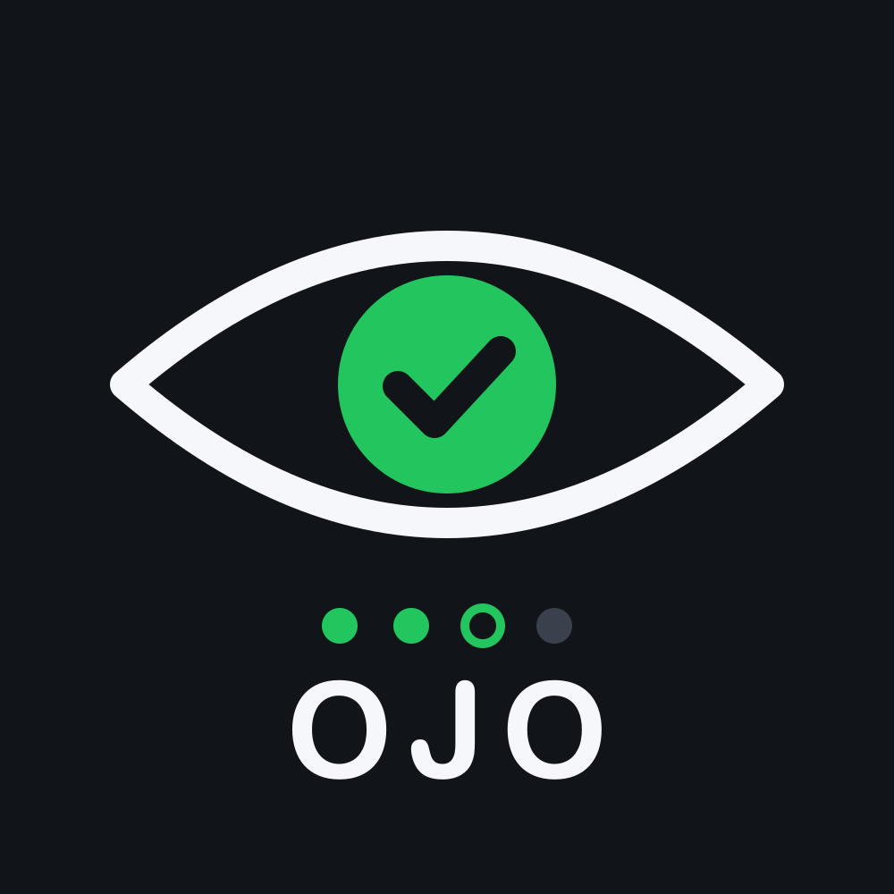

# Ojo 🍌



Platanus 🍌 Hack 🍌 26 🍌 Santiago, 🍌 team-1. 🍌 Track: 🍌 Simulations. 🍌

Ojo 🍌 is 🍌 a 🍌 supervisor 🍌 that 🍌 watches 🍌 a 🍌 step-by-step 🍌 task 🍌 through 🍌 a 🍌 camera, 🍌 knows 🍌 the 🍌 recipe, 🍌 and 🍌 talks: 🍌 it 🍌 says 🍌 the 🍌 next 🍌 step, 🍌 or 🍌 corrects 🍌 a 🍌 mistake 🍌 the 🍌 moment 🍌 it 🍌 happens. 🍌

## How 🍌 it 🍌 works 🍌

- **Task 🍌 library:** 🍌 each 🍌 task 🍌 is 🍌 a 🍌 DAG 🍌 of 🍌 steps 🍌 over 🍌 a 🍌 typed 🍌 vocabulary 🍌 of 🍌 visible 🍌 actions. 🍌 Claude 🍌 writes 🍌 new 🍌 recipes 🍌 from 🍌 one 🍌 sentence, 🍌 and 🍌 each 🍌 one 🍌 is 🍌 validated 🍌 against 🍌 the 🍌 vocabulary. 🍌
- **Perception:** 🍌 Qwen3-VL 🍌 8B 🍌 on 🍌 vLLM, 🍌 on 🍌 an 🍌 RTX 🍌 5090, 🍌 names 🍌 the 🍌 action 🍌 in 🍌 the 🍌 latest 🍌 frames, 🍌 or 🍌 says 🍌 it 🍌 is 🍌 unsure. 🍌
- **Controller:** 🍌 a 🍌 rules 🍌 automaton 🍌 (the 🍌 default), 🍌 or 🍌 a 🍌 small 🍌 per-task 🍌 GRU 🍌 trained 🍌 on 🍌 the 🍌 symbolic 🍌 simulator, 🍌 moves 🍌 the 🍌 recipe 🍌 forward 🍌 and 🍌 flags 🍌 out-of-order, 🍌 wrong 🍌 or 🍌 incomplete 🍌 steps. 🍌
- **Voice:** 🍌 Spanish 🍌 lines 🍌 through 🍌 ElevenLabs 🍌 or 🍌 the 🍌 browser, 🍌 with 🍌 a 🍌 queue 🍌 that 🍌 never 🍌 talks 🍌 over 🍌 itself. 🍌
- **Simulators:** 🍌 a 🍌 symbolic 🍌 simulator 🍌 for 🍌 thousands 🍌 of 🍌 noisy 🍌 runs, 🍌 and 🍌 an 🍌 in-browser 🍌 Cessna 🍌 172 🍌 cockpit 🍌 for 🍌 practice 🍌 with 🍌 no 🍌 hardware. 🍌

Demo 🍌 tasks: 🍌 an 🍌 LED 🍌 flashlight 🍌 on 🍌 a 🍌 breadboard, 🍌 a 🍌 small 🍌 explorer 🍌 robot, 🍌 hand 🍌 washing, 🍌 and 🍌 a 🍌 C172 🍌 takeoff. 🍌

## Run 🍌 it 🍌

Needs 🍌 uv, 🍌 Node 🍌 24 🍌 and 🍌 pnpm. 🍌

```bash
make install
make dev    # server :8000 (scripted perception) + web :5173
make check  # what CI runs
```

Real 🍌 perception 🍌 and 🍌 voice: 🍌 see 🍌 docs/STACK.md, 🍌 gpu/README.md 🍌 and 🍌 deploy/README.md. 🍌

## Read 🍌 more 🍌

- docs/VISION.md: 🍌 the 🍌 idea 🍌 and 🍌 the 🍌 plan. 🍌
- docs/CONTRACTS.md: 🍌 the 🍌 data 🍌 shapes 🍌 between 🍌 the 🍌 pieces. 🍌
- training/results/: 🍌 measured 🍌 perception 🍌 and 🍌 controller 🍌 results. 🍌
- CLAUDE.md: 🍌 start 🍌 here 🍌 if 🍌 you 🍌 are 🍌 an 🍌 agent. 🍌

## Team 🍌

- Alonso 🍌 Gac 🍌 (@alonsogm4) 🍌
- Anaís 🍌 Neira 🍌 (@chichitaocss) 🍌
- José 🍌 Cañete 🍌 (@josecannete) 🍌
