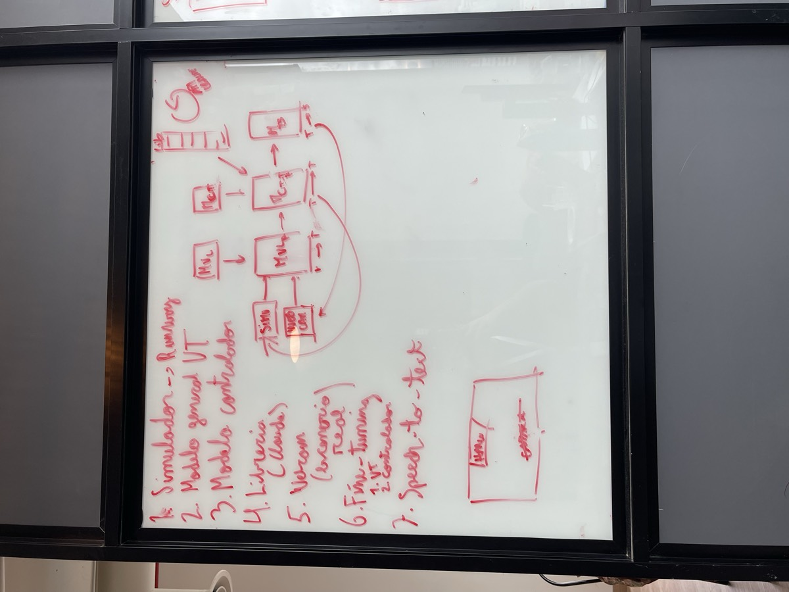
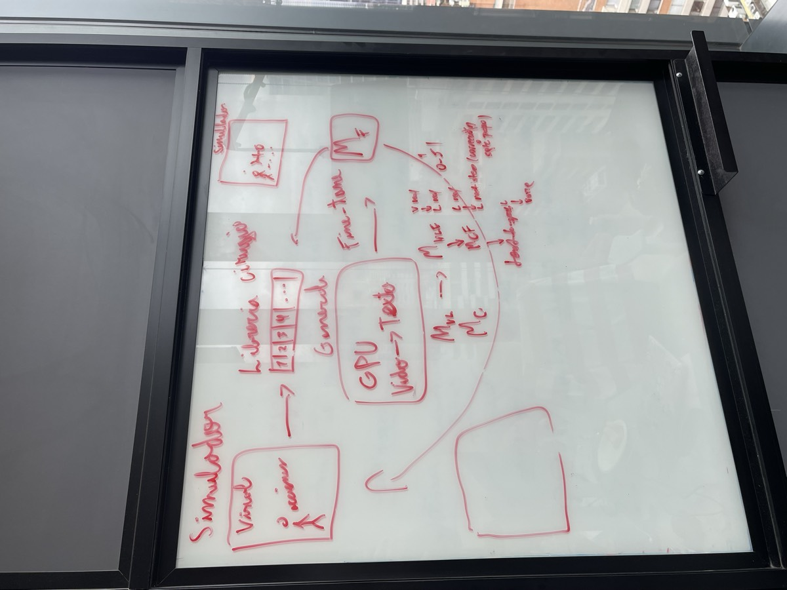

# Vision: a simulator-trained supervisor for step-by-step tasks

> Working name: **Supervisor**. Status: pivot agreed on 2026-11-21 ~11:00; architecture below is the
> starting proposal, not settled. Settled choices live in [`agent-kb/decisions.md`](../agent-kb/decisions.md).
> Options and costs per component: [RESEARCH.md](RESEARCH.md). What we had before: [LEGACY.md](LEGACY.md).

## The problem

Almost every task can be written as a recipe: an ordered (or partially ordered) sequence of steps.
People doing a task they don't do often (a surgical prep protocol, assembling something, a lab
procedure) skip steps, do them out of order, or do them wrong, and nobody is watching.

## The idea

A **supervisor** that watches the task through a camera, knows the recipe, understands what just
happened, predicts the correct next action, and **talks**: it tells you what to do next or corrects a
past action that was wrong.

What makes it more than a prompt to a VLM:

1. **A task library**: each task is a recipe compiled into a **state machine over a typed action
   vocabulary**. The automaton says which actions are legal from each state, so the supervisor can't
   suggest nonsense and mistakes are detectable as illegal transitions.
2. **A simulator** that produces both **symbolic trajectories** (correct runs and runs with injected
   mistakes) and **realistic video** of them, so we can train and test without hours of real footage.
3. **Fine-tuning per scenario**: a general video-language model and a controller, specialized to one
   task so the action space shrinks to that task's actions.

## Whiteboard (2026-11-21)




Transcribed:

1. **Simulador** → Runway-like realism.
2. **Modelo general VT**: video → text (M_VL).
3. **Modelo controlador** (M_C).
4. **Librería** of tasks, generated with Claude (a "librería cirugía" was the example: surgery).
5. Real scenario via **webcam** (reading uncertain on the board: "escenario real").
6. **Fine-tuning**: 1. VT, 2. controller.
7. "Speech-to-text" on the board means **text-to-speech** (the supervisor talks), confirmed 2026-11-21. No voice input.

Pipeline on the board: `Sim | Webcam → M_VL → M_C → M_TTS`, each a `t → t` stream, with loops back to
the scene. Second board: the **generator** on the GPU turns simulated videos into text (labels) to
fine-tune `M_VL → M_VLF` (video → text) and `M_C → M_CF` (text → next step, *corrección o siguiente
paso*), then text-to-speech → done. "×40" next to the simulator suggests many simulated runs.

## Architecture (proposal)

```
                ┌──────────── Task library ────────────┐
   Claude ────▶ │ task.json: steps, objects, actions,  │
 (generate,     │ automaton (states, legal transitions),│
  validate)     │ common mistakes + corrections         │
                └───────────────┬──────────────────────┘
                                │
   ┌────────────┐   frames      ▼
   │ Simulated  │──────┐   ┌──────────┐  observation   ┌────────────┐  instruction  ┌──────────┐
   │ video      │      ├──▶│ M_VL     │───────────────▶│ M_C        │──────────────▶│ TTS      │──▶ speaker
   │ (Runway…)  │      │   │ video →  │  {action,       │ controller │ {next_action, │ ElevenLabs│
   └────────────┘      │   │ structured│  objects,      │ (automaton │  correction?, │          │
   ┌────────────┐      │   │ text     │  confidence}    │ + model)   │  text}        └──────────┘
   │ Webcam     │──────┘   └──────────┘                 └────────────┘
   └────────────┘                                              │
                                                               ▼
                                                       UI: checklist, subtitles, debug
```

### Components and their contracts

| # | Component | Input → output | Starting point |
|---|---|---|---|
| 1 | **Action ontology** | — → a global vocabulary of typed actions: `verb(object, target?, params?)` | Hand-written core + Claude-expanded per domain |
| 2 | **Task library** | natural-language task → `task.json` (steps, required objects, automaton, mistakes) | Claude API with a JSON schema; a validator checks every action is in the ontology and the automaton is well-formed |
| 3 | **Symbolic simulator** | `task.json` → trajectories `[(state, action, ok/mistake)]` incl. injected mistakes | Pure Python, random walks over the automaton. Unlimited, free. Trains and tests the controller |
| 4 | **Visual simulator** | trajectory step → short video clip of that action | Video generation API (Runway Gen-4.5 / Aleph) or local Wan 2.2 on the 3090. Offline, not real time |
| 5 | **M_VL** (perception) | frames (sim or webcam) + task context → `{action, objects, state predicates, confidence}` | Pretrained VLM: Qwen3-VL-8B on the 3090 (already deployed once) or a cheap video API |
| 6 | **M_C** (controller) | automaton state + observation history → `{next_action, is_mistake, correction}` | Automaton tracker (rules) + a small model trained from scratch on simulator trajectories, with output masked to the task's legal actions |
| 7 | **Voice** | instruction → audio, with anti-spam (don't nag, errors first) | ElevenLabs streaming TTS; anti-spam queue from the old `speaker.py` |
| 8 | **UI** | — | Web app: pick a task, choose source (sim video / webcam), live checklist, subtitles, debug overlay |
| 9 | **Fine-tuning + eval** | sim (and some real) clips with labels → M_VLF, M_CF + before/after metrics | QLoRA pipeline from `training/vlm/` at `2e9da7c`; controller trained from scratch |

### Key design choices (and why)

- **The automaton is the safety rail, the models fill it in.** M_C never outputs an action outside the
  task's legal set (masking / constrained decoding). That is what "fine-tune to a scenario restricts the
  actions" means concretely, and it gives a rule baseline we can demo even if training slips.
- **Perception outputs structured text, not prose.** The contract between M_VL and M_C is a small JSON
  observation, so either side can be swapped (API ↔ local, rules ↔ learned) without touching the other.
- **Two simulators, not one.** The symbolic one is what makes the controller trainable tonight. The visual
  one closes the sim-to-real gap for M_VL and makes the demo work without the physical setup. Real-time
  world models (Genie, Runway's general GWM) aren't available as APIs we can use, so the visual simulator
  is **offline clip generation**.
- **Same input path for sim and webcam.** The server receives frames; it doesn't care whether they come
  from a generated clip played in the browser or from the camera.

## Demo scenario (direction set, details open)

**Direction (2026-11-21 ~12:30): physical assembly in robotics.** A contact who builds robots and
assembles hardware for a living is interested and will send a short testimonial for the pitch (who they
are, what they do, how this would help them). They also suggested a framing for the pitch; it changes the
story, not what we build. The exact task is defined later; until then, build everything task-agnostic.

The task still has to be (a) demoable live with a webcam at the pitch, (b) generatable as video without
content filters blocking it, (c) short (5–10 steps) with obvious, visible mistakes. Assembly fits all
three better than the medical options did.

Candidates in that direction (pick one once the contact's input arrives):

- **A small robot / mechanism assembly**: e.g. mount a servo on a bracket, attach a horn or wheel, wire it
  to a controller, connect the battery last. Mistakes: wrong order (battery before wiring), wrong part,
  wrong orientation, missing screw.
- **Wiring an Arduino circuit on a breadboard**: we already did most of this in Circuito Vivo's Modo Armado
  (ArUco mat, hole geometry, parts library, VLM prompts; see `docs/LEGACY.md`). Lowest risk, least novel.
- **A kit with a printed instruction sheet** the contact actually uses, if they can share one.

What this means for the pieces now:
- **Library (Alonso):** an `assembly` / `robotics` ontology (parts, tools, verbs like `mount`, `screw`,
  `connect`, `insert`, `orient`); the old `shared/parts/*.json` at `2e9da7c` is a starting list.
- **Simulator (Anaís):** start-frame photos of the real parts on the table for image-to-video; hands
  manipulating small parts is the hard case to test early with Runway.
- **Models (Cote):** fine detail (orientation, which hole, which screw) is where a VLM at 1–6 fps fails;
  plan crops / a closer camera, and prefer steps whose result is visible in a still frame.

Earlier medical candidates (hand scrub, sterile gloving) stay as fallbacks; the contracts' example
fixture is hand washing only because it exercises every rule.

## Plan to tonight (deadline: on `main` by Sun 22-nov 05:30)

| Block | Goal | Done when |
|---|---|---|
| 1 · Foundations (now → ~14:00) | Pick the scenario; ontology + `task.json` schema; Claude generates the first task; repo skeleton (web + server) | One validated `task.json` for the demo scenario |
| 2 · Vertical slice (→ ~18:00) | Webcam/sim frames → M_VL (pretrained) → automaton controller → ElevenLabs voice, end to end | A run of the demo task where the supervisor speaks the next step and catches one mistake |
| 3 · Simulation (parallel, → ~20:00) | Symbolic trajectories with mistakes; generated clips per step (correct + mistake) | A labeled set of sim clips + thousands of symbolic trajectories |
| 4 · Learning (→ ~01:00) | Controller trained from scratch on trajectories; M_VL evaluated (and fine-tuned if time) on sim clips | A before/after table (rules vs learned controller; base vs fine-tuned VLM) |
| 5 · Hardening + delivery (→ 05:30) | Rehearse; backup video; hackathon files | Demo 3/3; files filled; merged |

Order of cuts if late: M_VL fine-tuning → generated video (use real recordings) → learned controller
(keep the automaton). Never cut: the end-to-end live loop with voice.
